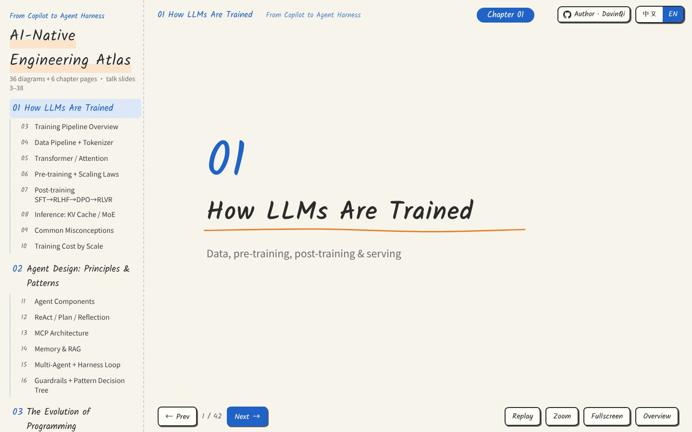
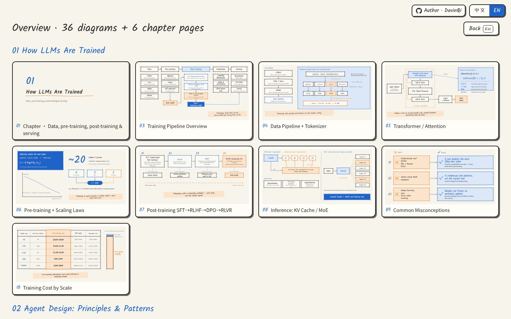
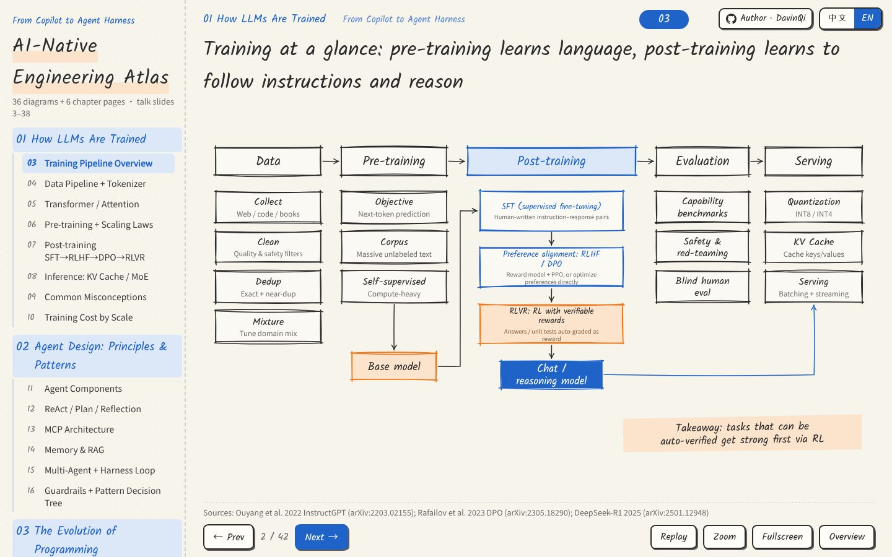
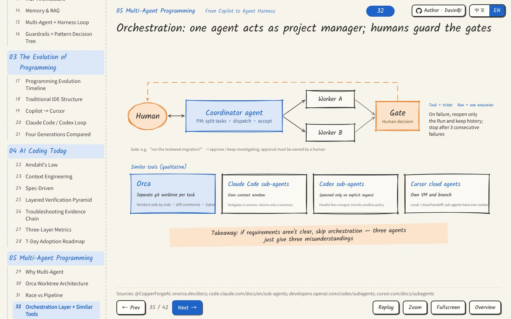
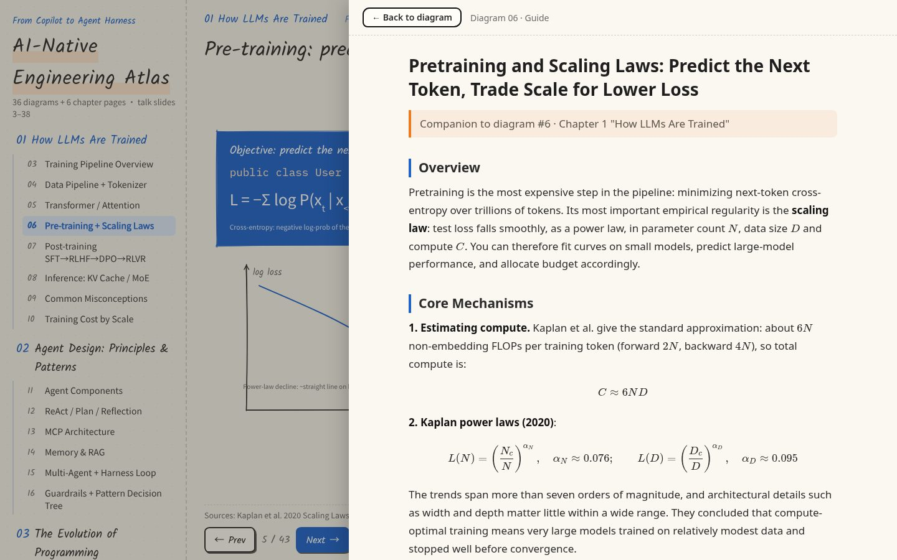
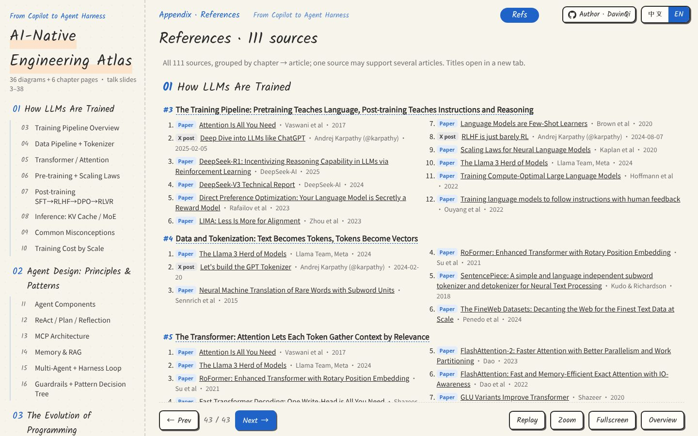
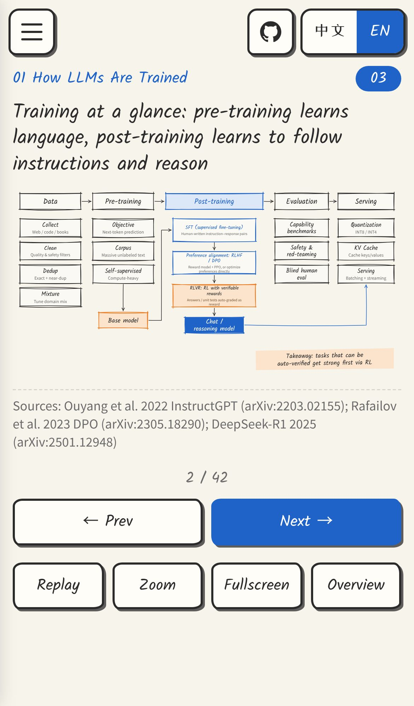
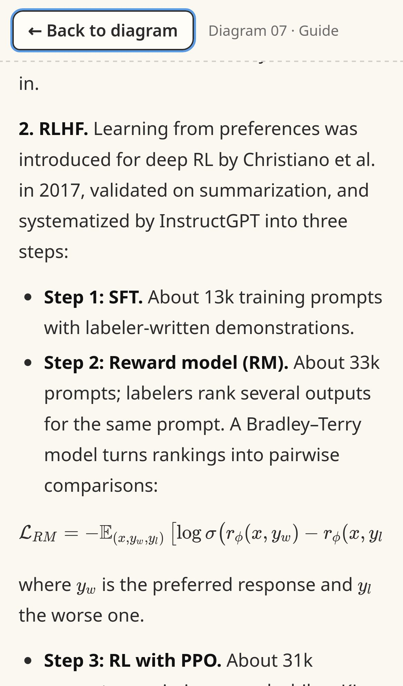

**English** | [简体中文](README.zh-CN.md)

# AI-Native Engineering Atlas

A hand-drawn style, bilingual (English / 中文) atlas of AI-native software engineering, **from Copilot to Agent Harness**: 37 diagrams + 6 chapter pages.

**Live site:** [English](https://davinqi.github.io/ai-atlas/?lang=en) · [中文](https://davinqi.github.io/ai-atlas/?lang=zh)

## Chapters
1. **How LLMs Are Trained**: data, pre-training, post-training (SFT / RLHF / DPO / RLVR), inference, misconceptions, training cost
2. **Agent Design: Principles & Patterns**: components, ReAct / Plan / Reflection, MCP, memory & RAG, multi-agent harness, guardrails
3. **The Evolution of Programming**: from assembly and IDEs to Copilot, AI IDEs and coding agents
4. **AI Coding Today**: Amdahl's law, context engineering, spec-driven development, layered verification, metrics, a 7-day roadmap
5. **Multi-Agent Programming**: why multi-agent, worktree isolation, race vs pipeline, orchestration, humans + agents
6. **How AI Reshapes the Dev Lifecycle**: CI/CD → AIOps self-healing → the future, roles and open questions

## Features
- **Bilingual toggle:** 中文 / EN switch in the top-right corner. The default follows your browser language, your choice is remembered, and it is reflected in the URL (`?lang=en|zh`).
- **Hand-drawn diagrams:** sketch-style inline SVG with animated arrows. Click any diagram to zoom and pan.
- **Keyboard shortcuts:** `←` `→` page · `Enter` zoom · `F` fullscreen · `G` overview grid · `R` replay animation · `Esc` close.
- **Handbook guides:** every diagram has a **Read the guide** button that opens a long-form article that explains mechanisms, reasoning, worked examples, trade-offs and pitfalls, structured to fit each topic, with KaTeX-rendered formulas; sources are collected on the final References page. On desktop it opens as a side reading panel; on phones it opens full screen with a back button. It follows the language toggle, and you can link to it directly, e.g. [`#7/guide`](https://davinqi.github.io/ai-atlas/?lang=en#7/guide).
- **References page:** the last page, [`#refs`](https://davinqi.github.io/ai-atlas/?lang=en#refs), lists 30 core sources (papers, docs, X posts) grouped by chapter, with type badges, links and the diagrams each one supports; the full list of 131 sources is in [`docs/references.json`](docs/references.json).
- **Mobile friendly:** on phones and tablets the sidebar becomes a drawer (☰). On phones held upright, every diagram and chapter cover has its own hand-drawn portrait version, which is also used in the zoom view and the overview. you swipe left/right to change pages, tap a diagram to open the zoom view (pinch, double-tap to toggle fit/zoom, a Reset button), and every button is a ≥44px touch target. The desktop layout is unchanged.
- **Deep links:** `#12` opens diagram 12, `#ch3` opens the chapter 3 cover, e.g. [`?lang=en#ch3`](https://davinqi.github.io/ai-atlas/?lang=en#ch3). Add `&static` to disable animations.

## Screenshots
| Chapter cover | Overview grid |
|---|---|
|  |  |
| **Training pipeline** | **Multi-agent orchestration** |
|  |  |

**Handbook guide (desktop) and references page:**

| Guide | References |
|---|---|
|  |  |

**On mobile (iPhone 14): portrait diagram and guide:**

 

## Run locally
The site is plain static files with no build step.
```bash
git clone https://github.com/DavinQi/ai-atlas.git
cd ai-atlas
python3 -m http.server 8000   # then open http://localhost:8000/?lang=en
```
Diagrams also work if you open `index.html` directly, but the guides are loaded with `fetch`, so use a local server to read them.

## Files
`index.html` (entry) · `assets/atlas.js` (renderer, diagrams, i18n dictionary) · `assets/style.css` · `assets/guide/{zh,en}/N.html` (handbook articles, pre-rendered from Markdown) · `assets/katex/` (bundled KaTeX CSS + fonts, MIT) · `assets/fonts/` (subset web fonts, SIL OFL)

## Author
[DavinQi](https://github.com/DavinQi)
