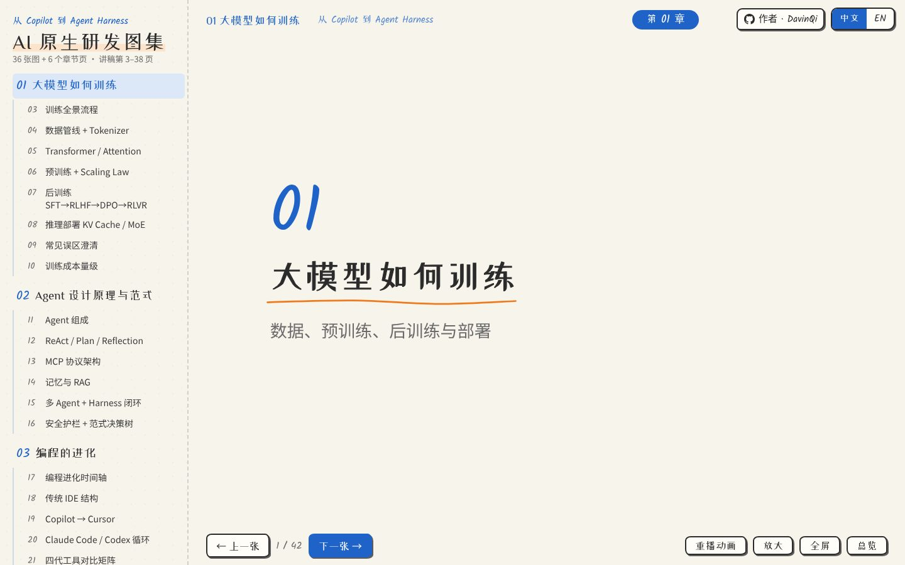
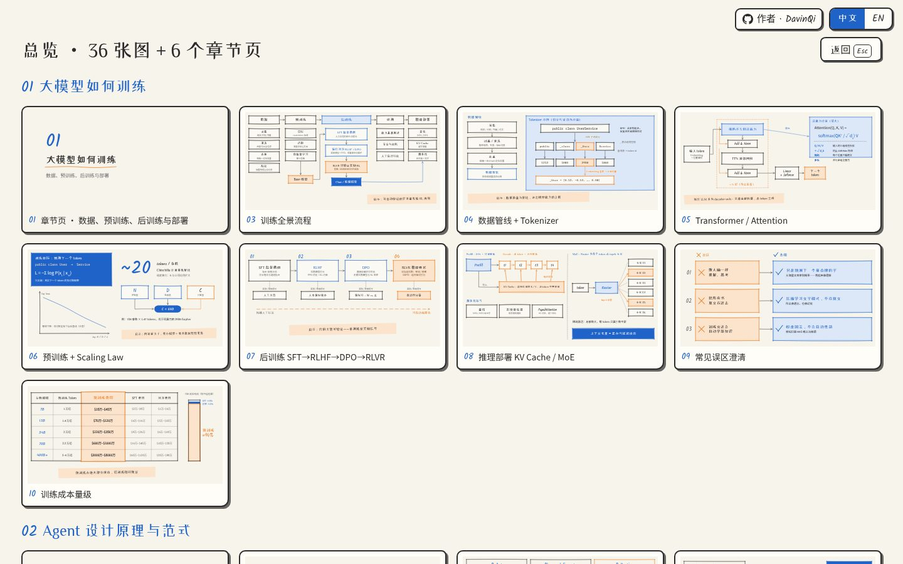
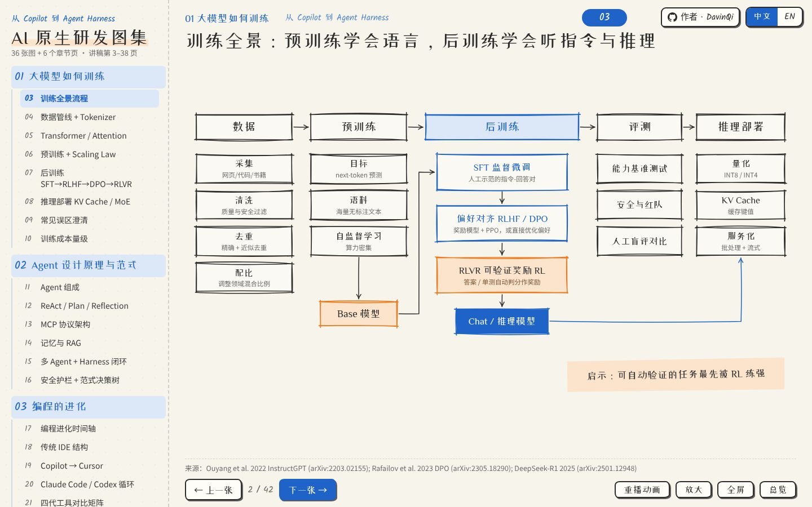
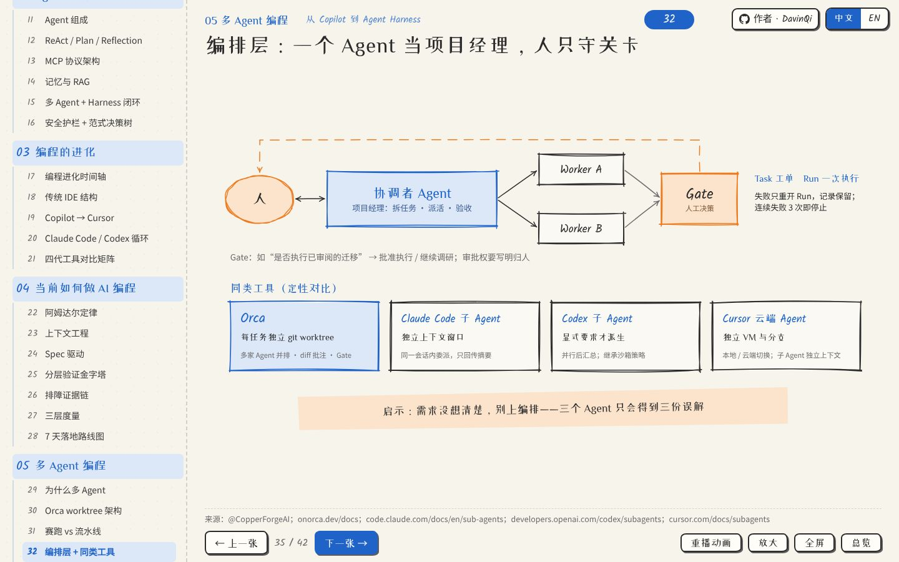
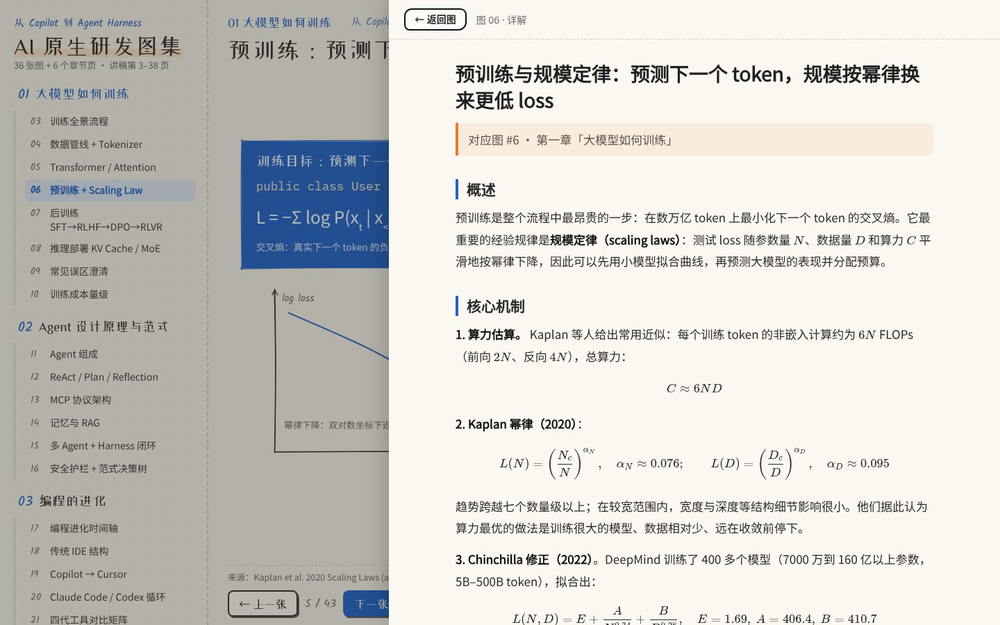
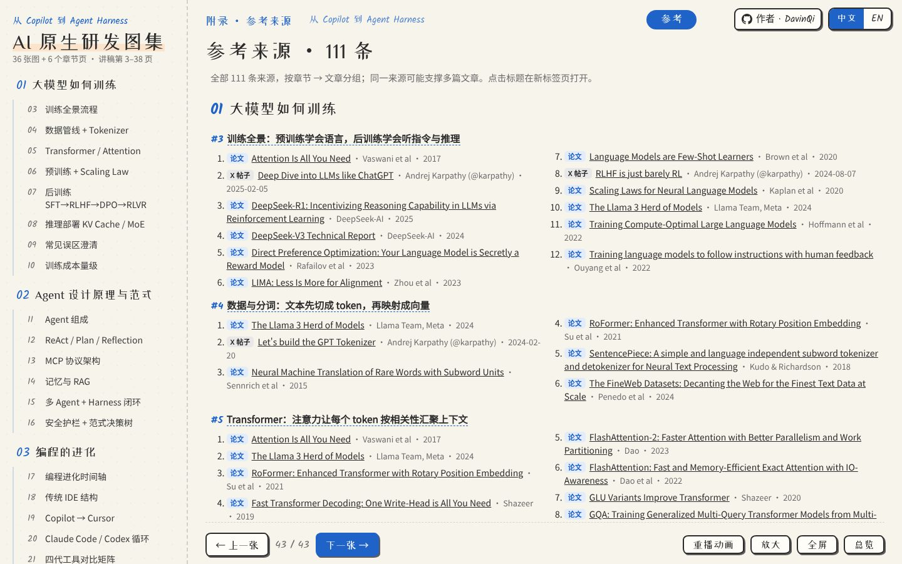
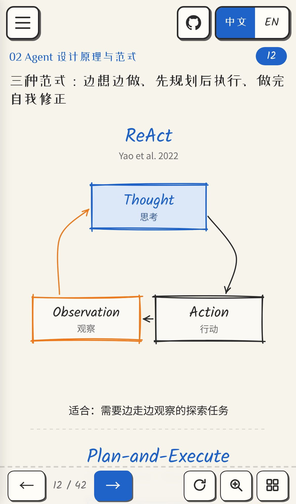
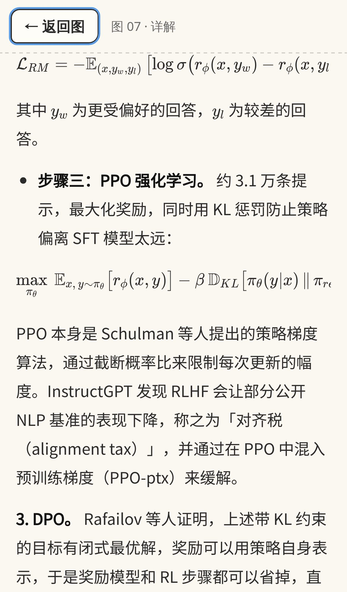

[English](README.md) | **简体中文**

# AI 原生研发图集

手绘风、中英双语的 AI 原生研发图集，**从 Copilot 到 Agent Harness**：37 张图 + 6 个章节页。

**在线访问：** [中文](https://davinqi.github.io/ai-atlas/?lang=zh) · [English](https://davinqi.github.io/ai-atlas/?lang=en)

## 章节
1. **大模型如何训练**：数据、预训练、后训练（SFT / RLHF / DPO / RLVR）、推理部署、常见误区、训练成本
2. **Agent 设计原理与范式**：组成、ReAct / 规划 / 反思、MCP、记忆与 RAG、多 Agent 与 Harness、安全护栏
3. **编程的进化**：从汇编、IDE 到 Copilot、AI IDE 和 Coding Agent
4. **当前如何做 AI 编程**：阿姆达尔定律、上下文工程、Spec 驱动、分层验证、度量、7 天落地路线图
5. **多 Agent 编程**：为什么多 Agent、worktree 隔离、赛跑与流水线、编排层、多人 + 多 Agent 协作
6. **AI 改变研发流程**：传统 CI/CD → AIOps 自修复 → 未来形态，角色变化与未解问题

## 功能
- **中英切换**：右上角 中文 / EN 按钮。默认跟随浏览器语言，记住你的选择，并同步到网址（`?lang=zh|en`）。
- **手绘风图示**：草图风格的 SVG，箭头带动画；点击图可放大、拖拽平移。
- **快捷键**：`←` `→` 翻页 · `Enter` 放大 · `F` 全屏 · `G` 总览 · `R` 重播动画 · `Esc` 关闭。
- **手册详解**：每张图都有「阅读详解」按钮，打开对应的长文：讲清机制、原理、算例、权衡与常见误区，每篇结构按内容而定；公式用 KaTeX 渲染，来源统一放在最后的参考来源页。桌面端以侧边阅读面板打开，手机端全屏打开并带返回按钮；跟随中英切换，并可直接链接，例如 [`#7/guide`](https://davinqi.github.io/ai-atlas/?lang=zh#7/guide)。
- **参考来源页**：最后一页 [`#refs`](https://davinqi.github.io/ai-atlas/?lang=zh#refs)，按章节列出 30 条核心来源（论文、文档、X 帖子），带类型标签、链接及其支撑的图解编号；完整的 143 条来源清单在 [`docs/references.json`](docs/references.json)。
- **适配手机**：在手机和平板上，侧栏变成抽屉菜单（☰）；竖屏手机上，每张图和章节页都有单独手绘的竖版，放大层和总览也使用竖版；左右滑动翻页，点击图进入放大层（双指缩放、双击切换适应/放大、「复原」按钮），按钮触控区域都不小于 44px。桌面版样式保持不变。
- **深链接**：`#12` 直达第 12 张图，`#ch3` 直达第 3 章章节页，例如 [`?lang=zh#ch3`](https://davinqi.github.io/ai-atlas/?lang=zh#ch3)；加 `&static` 可关闭动画。

## 截图
| 章节页 | 总览 |
|---|---|
|  |  |
| **训练全景流程** | **多 Agent 编排层** |
|  |  |

**手册详解（桌面）与参考来源页：**

| 详解 | 参考来源 |
|---|---|
|  |  |

**手机效果（iPhone 14）：竖版图与详解**

 

## 本地运行
纯静态文件，无需构建。
```bash
git clone https://github.com/DavinQi/ai-atlas.git
cd ai-atlas
python3 -m http.server 8000   # 然后打开 http://localhost:8000/?lang=zh
```
直接用浏览器打开 `index.html` 也能看图，但详解通过 `fetch` 加载，阅读详解需要用本地服务器。

## 文件
`index.html`（入口）· `assets/atlas.js`（渲染引擎、图、翻译词典）· `assets/style.css` · `assets/guide/{zh,en}/N.html`（手册文章，由 Markdown 预渲染）· `assets/katex/`（本地打包的 KaTeX CSS 与字体，MIT）· `assets/fonts/`（字体子集，SIL OFL 许可）

## 作者
[DavinQi](https://github.com/DavinQi)
